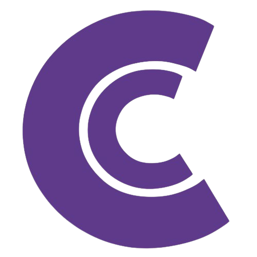

<div align="center">



# HUSBA DIGITAL

**Digital Solutions & IT Services Company — Premium Animated Portfolio**

Dark, cinematic, and buttery-smooth. The HUSBA DIGITAL site is a multi-page React experience built with GSAP-driven scroll choreography, Lenis smooth scrolling, a custom cursor, film-grain texture, and a purple-violet brand system.

</div>

---

## ✨ Highlights

- **🎬 GSAP + ScrollTrigger** timelines power every reveal, stagger, pin, and marquee across the site
- **🪶 Lenis smooth scroll** — physics-based inertia wired directly into `gsap.ticker`
- **🖱️ Custom cursor** — magnetic-feeling dot with `mix-blend-difference`, grows on interactive elements
- **🎥 Full-viewport poster sections** with pinned GSAP scenes, sheen overlays, and archive grids
- **📜 Cinematic loader** — letter-by-letter wordmark reveal, colored bars, and scanline wipe
- **🧊 Glassmorphism + grain** — `backdrop-blur` navbar, SVG film-grain overlay, purple glow orbs
- **📱 Fully responsive** — dedicated mobile overrides, `100dvh` sections, reflowed grids
- **⚡ Vite-first** — instant HMR, tree-shaken Lucide icons, ~5 KB gzipped CSS

## 🧱 Tech Stack

| Layer | Tool |
| --- | --- |
| Build | **Vite 5** |
| Framework | **React 18** |
| Routing | **React Router DOM 6** |
| Styling | **Tailwind CSS 3** |
| Animation | **GSAP 3 + ScrollTrigger** |
| Smooth Scroll | **Lenis** |
| 3D (ready) | **Three.js + React Three Fiber + Drei** |
| Icons | **Lucide React** |

## 🗂️ Project Structure

```
├── index.html              # Entry HTML + meta tags
├── public/
│   └── logo.png            # Brand favicon / loader mark
└── src/
    ├── main.jsx            # React DOM entry
    ├── App.jsx             # Router + Lenis + GSAP + loader + cursor
    ├── index.css           # Tailwind base + design-system classes
    ├── components/
    │   ├── Navbar.jsx      # Floating nav, glass on scroll, mobile menu
    │   ├── Hero.jsx        # Animated hero: orbs, grid, GSAP timeline
    │   ├── Services.jsx    # 6-card services grid
    │   ├── Footer.jsx      # 4-column footer with reveals
    │   └── HomeSections.jsx
    └── pages/
        ├── Home.jsx        # /   Hero → Services → Stats → CTA
        ├── Projects.jsx    # /projects  Filterable project grid
        ├── About.jsx       # /about  Values → Timeline → Team
        └── Contact.jsx     # /contact  Form + FAQ accordion
```

## 🚀 Getting Started

```bash
# 1. Install dependencies
npm install

# 2. Start the dev server (port 5000)
npm run dev

# 3. Production build
npm run build

# 4. Preview the production build
npm run preview
```

> **Note:** `.npmrc` pins `legacy-peer-deps=true` to keep React 18 compatible with `@react-three/drei@10`.

## 🎨 Brand System

- **Primary:** `#643D91` · **Violet:** `#A78BFA` · **Rose:** `#8b6be0`
- **Background:** `#0F172A` (dark-900) → `#020617` (dark-950)
- Full Tailwind `brand` scale in `tailwind.config.js`
- Typography: **Inter** (sans), **Instrument Serif** (display), **Caveat** (hand)

## 🧾 Understanding The Animation Patterns

Everything is coordinated from `src/App.jsx`:

```js
const lenis = new Lenis({ duration: 1.2, easing: (t) => Math.min(1, 1.001 - Math.pow(2, -10 * t)) })
lenis.on('scroll', ScrollTrigger.update)
gsap.ticker.add((time) => lenis.raf(time * 1000))
```

Scroll-triggered reveals follow a consistent shape:

```js
gsap.from('.service-card', {
  y: 80, opacity: 0,
  stagger: 0.1,
  scrollTrigger: { trigger: '.service-grid', start: 'top 80%' }
})
```

A deeper technical write-up lives in [`PROJECT.md`](./PROJECT.md).

## 🤝 Contributing

1. Fork it
2. Create your feature branch (`git checkout -b feat/amazing`)
3. Commit your changes (`git commit -m 'Add something amazing'`)
4. Push to the branch (`git push origin feat/amazing`)
5. Open a Pull Request

## 📄 License

[MIT](./LICENSE) © HUSBA DIGITAL